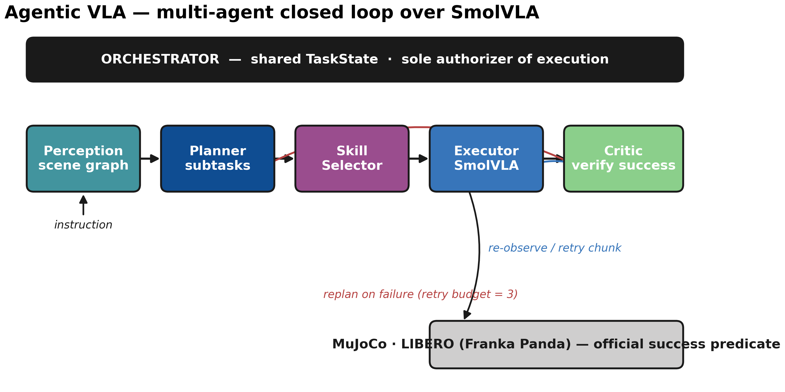
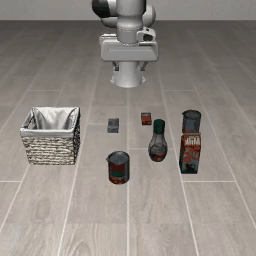
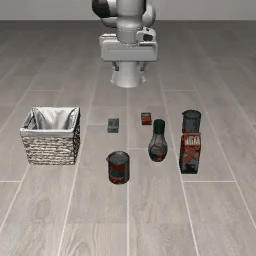
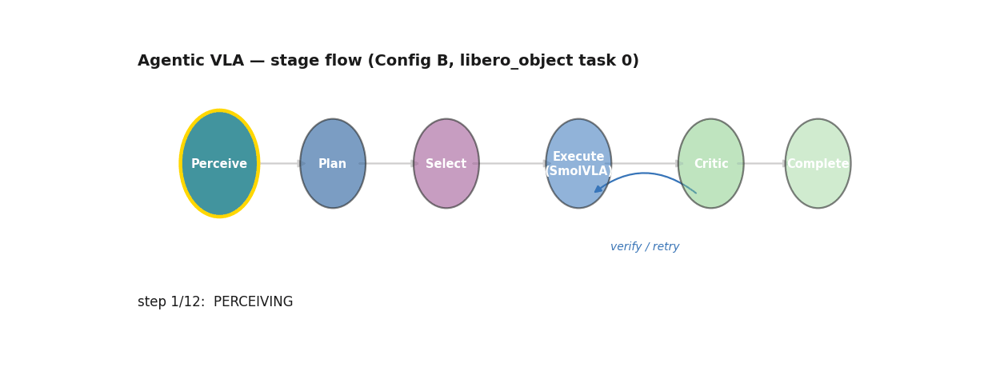
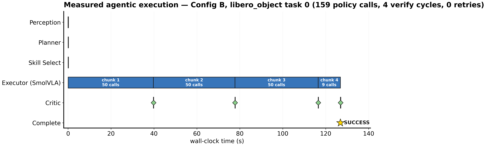
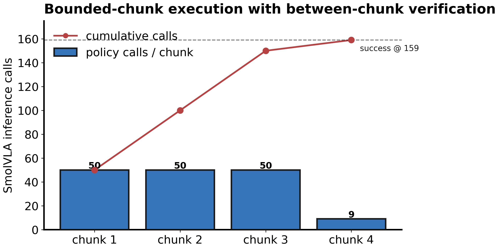

<div align="center">

# Agentic VLA

### A hierarchical multi-agent controller for closed-loop Vision–Language–Action manipulation

**SmolVLA · LIBERO · MuJoCo · Franka Panda** — runs offline on a single 6 GB RTX 4050

<sub>Planner · Perception · Skill-Selection · Executor · Critic, coordinated by an orchestrator that verifies every action against the official benchmark signal.</sub>

</div>

---

## Abstract

Monolithic Vision–Language–Action (VLA) policies map an instruction and pixels directly
to actions in an **open loop**: they emit motions until the horizon ends, with no explicit
check that the task actually succeeded, and no principled way to recover from failure. We
wrap a pretrained VLA policy (**SmolVLA**) in a **five-agent closed loop** —
*perceive → plan → select → execute → verify → recover* — coordinated by an orchestrator
that holds the single source of truth (a shared `TaskState`) and is the *only* component
permitted to authorize an environment step. Execution is **bounded and verified**: the
policy runs a short action chunk, then a Critic checks the **official LIBERO success
predicate** before the next chunk is authorized. Scoring is strictly vision-only; ground-
truth simulator state is used only for labeled diagnostics and never mixed into reported
success. The system is fully reproducible on commodity hardware (6 GB VRAM, offline after
caching) and is evaluated on the LIBERO benchmark in MuJoCo.

<div align="center">

<br><sub><b>Figure 1.</b> The orchestrator holds the shared <code>TaskState</code> and authorizes execution. Perception → Planner → Skill-Selector → Executor (SmolVLA) → Critic form a closed loop with re-observe/retry and replan-on-failure feedback paths (retry budget = 3). Scoring uses the official LIBERO success predicate.</sub>
</div>

---

## 1. Why agentic?

A baseline VLA is `instruction → SmolVLA → env`. It cannot tell whether it *succeeded*,
only that it *finished emitting actions*. The agentic layer adds the missing control
structure, mapping one-to-one onto the operating loop:

| Agent | Question it answers | Implementation |
|---|---|---|
| **Planner** | *What needs to happen?* | subtask decomposition (rules → optional Qwen2.5-3B) |
| **Perception** | *What is happening?* | structured scene graph (no fabricated coordinates) |
| **Skill-Selector** | *How do we proceed?* | registry mapping — a skill **name ≠ a capability** |
| **Executor** | *Do it* | SmolVLA through LeRobot's validated processor pipeline |
| **Critic** | *Did it work?* | official LIBERO predicate → SUCCESS / RECOVERY / … |

> **Design principle (enforced in code).** *Validate interfaces before execution; never
> silently reshape.* A policy whose observation/action contract does not match the
> environment is **rejected**, not coerced — see §5.

---

## 2. Live rollouts on MuJoCo

<div align="center">

| Agentic (Config B) — **100% success** | Baseline (Config A) — **100% success** |
|:---:|:---:|
|  |  |
| orchestrator → SmolVLA, verified in chunks | `lerobot-eval`, single open loop |

<sub>Task: <i>"pick up the alphabet soup and place it in the basket"</i> · <code>libero_object</code> task 0 · Franka Panda · official LIBERO success predicate. Full-res MP4s in <a href="videos/"><code>videos/</code></a>.</sub>

</div>

---

## 3. Anatomy of one agentic episode

The orchestrator records every state transition. Below is the **measured** flow of the
Config B rollout above — reconstructed directly from
[`runs/agenticB_mujoco_libero_object_1795731001/results.json`](runs/agenticB_mujoco_libero_object_1795731001/results.json).

<div align="center">

<br><sub><b>Animation.</b> The token traverses the real transition log: Perceive → Plan → Select → (Execute → Critic)×4 → Complete. The Execute→Critic feedback loop is the heart of the system — SmolVLA is never allowed to run unbounded.</sub>
</div>

<div align="center">

<br><sub><b>Figure 2.</b> Gantt of the measured episode. Rules-based Perception/Planner/Selection resolve in &lt;1 ms; the Executor runs SmolVLA in four bounded ~50-step chunks, with a Critic verification (♦) between each. Success fires mid-chunk-4; the episode completes at 159 policy calls, 0 retries.</sub>
</div>

<div align="center">

<br><sub><b>Figure 3.</b> Bounded-chunk execution. Each chunk is ≤50 SmolVLA inferences; the Critic checks the official success signal at every chunk boundary. The task is verified complete at 159 cumulative calls.</sub>
</div>

---

## 4. System design

**Shared state & control.** A single `TaskState` dataclass is the source of truth; only
the orchestrator mutates it, and every transition is appended to an immutable log (the
data behind Figure 2). Agents return **schema-validated** messages (pydantic); malformed
messages are rejected (fail-loud).

**Closed-loop state machine.**

```
INIT → PERCEIVE → PLAN → SELECT → EXECUTE → CRITIQUE
                            ▲                   │
                            │   SUCCESS ────────┤
                            │   UNCERTAIN → (next chunk)
                            └── RECOVERY_REQUIRED → RECOVER (re-observe, retry ≤ 3) → SELECT
                                overall success (LIBERO predicate) → COMPLETE
```

**Hardware-driven model residency (6 GB VRAM).** SmolVLA (450 M, bf16) stays resident
during execution; the optional reasoning LLM (Qwen2.5-3B, 4-bit) is **time-sliced** —
loaded between chunks and unloaded before the policy runs, so they never contend for VRAM.

**Honesty rules, enforced in code.**
- Success is the **official LIBERO predicate**, never "the executor finished."
- Ground-truth object state is **diagnostics-only**, labeled oracle-assisted, excluded from vision-only claims.
- Episodic memory stores experience; it does **not** train or adapt SmolVLA.

---

## 5. The interface-validation result (a feature, not a bug)

Running the *generic* `lerobot/smolvla_base` on LIBERO is **correctly refused** by the
pipeline: its config expects 3 cameras (`camera1/2/3`) + 6-D state/action with its own
normalization stats, while LIBERO provides 2 cameras (`image`/`image2`) + 7-D action.
The validator blocks the mismatch rather than silently reshaping. Using a LIBERO-matched
checkpoint (`HuggingFaceVLA/smolvla_libero`: 2 cameras, 7-D action, 8-D state) passes and
achieves the rollouts above. Full account in [`RUN_NOTES.md`](RUN_NOTES.md) and
[`DESIGN.md`](DESIGN.md) §0a.

---

## 6. Evaluation protocol

Three configurations on identical tasks/seeds/cameras (spec §10):

| | Pipeline |
|---|---|
| **A — Baseline** | `instruction → SmolVLA → env` |
| **B — Agentic** | `instruction → multi-agent orchestration → SmolVLA → env` |
| **C — Memory** | B + episodic memory (advisory retrieval; never overrides perception) |

**Measured so far** (`libero_object` task 0, official LIBERO predicate, RTX 4050):

| Config | Success | Policy calls | Verify cycles | Retries | Wall-clock |
|---|:---:|:---:|:---:|:---:|:---:|
| A (baseline, `lerobot-eval`) | ✅ 1/1 | — | — | — | 148 s |
| **B (agentic)** | ✅ 1/1 | 159 | 4 | 0 | 130 s |

> **Honest scope.** These are single-episode *functional* confirmations that each pipeline
> runs end-to-end on MuJoCo and is scored by the official predicate — not statistical
> success rates. On a task SmolVLA solves cleanly, Config B's *outcome* equals A (0
> retries fired); the agentic layer's value appears on **failure / recovery / long-horizon
> / multi-task** runs, which the A/B/C sweep (`agentic_vla/eval/runner.py`) is built to
> measure. Reported numbers are measured only — never fabricated.

---

## 7. Reproduce

```bash
# Python 3.10 venv reusing a working CUDA torch
py -3.10 -m venv .venv --system-site-packages
.venv\Scripts\python.exe -m pip install mujoco==2.3.7 robosuite==1.4.0 bddl==1.0.1 \
    hydra-core==1.2.0 easydict==1.9 einops gym==0.25.2 opencv-python thop cloudpickle
.venv\Scripts\python.exe -m pip install -e D:/path/to/LIBERO --no-deps --config-settings editable_mode=compat
.venv\Scripts\python.exe -m pip install "lerobot[smolvla]"
.venv\Scripts\python.exe -m pip install numpy==1.26.4 --no-deps   # robosuite/gym need <2
.venv\Scripts\python.exe scripts\setup_windows_env.py             # idempotent Windows fixups

# Verify the REAL interfaces (resolves every [TO-VERIFY] in DESIGN.md)
.venv\Scripts\python.exe scripts\00_verify_interfaces.py --suite libero_object

# Baseline (Config A)
.venv\Scripts\python.exe -m lerobot.scripts.lerobot_eval \
    --policy.path=<libero_finetuned_snapshot> --env.type=libero --env.task=libero_object \
    --eval.n_episodes=1 --policy.device=cuda

# Agentic (Config B / C) — orchestrator drives SmolVLA, with optional video
.venv\Scripts\python.exe scripts\03_run_agentic_mujoco.py \
    --policy-path=<libero_finetuned_snapshot> --suite libero_object --task 0 \
    --config B --chunk-steps 50 --record videos/run.mp4

# Regenerate the figures in this README
.venv\Scripts\python.exe figures\make_figures.py
```

Logic layer (agents, state machine, recovery, memory, metrics) is unit-tested **without**
the heavy stack: `py -3.10 -m pytest tests/ -q` → **15 passed**.

---

## 8. Repository layout

```
agentic_vla/
  orchestrator.py      5-agent state machine (sole authorizer of execution)
  state.py             shared TaskState + immutable transition log
  schemas.py           pydantic agent-message schemas (fail-loud)
  agents/              planner · perception · skill_selector · executor · critic · llm_backend
  skills/registry.py   name ≠ capability; explicit fallback, no silent substitution
  policy/
    smolvla_runner.py      SmolVLA adapter (fail-loud dim guards)
    lerobot_backend.py     bridge to LeRobot's validated env + processor pipeline
  memory/episodic.py   JSONL episodic store + advisory retrieval
  eval/                metrics + A/B/C benchmark runner
scripts/               00_verify_interfaces · 01_run_baseline · 02_run_agentic · 03_run_agentic_mujoco · setup_windows_env
figures/               make_figures.py + publication figures/animation
videos/                rollout recordings (mp4 + gif)
tests/                 15 tests, no heavy deps
DESIGN.md · RUN_NOTES.md   design decisions + measured bring-up log
```

---

<div align="center">
<sub>Built for reproducible, measurable, long-horizon autonomous manipulation.
Figures follow a publication style; all reported results are measured on MuJoCo.</sub>
</div>
